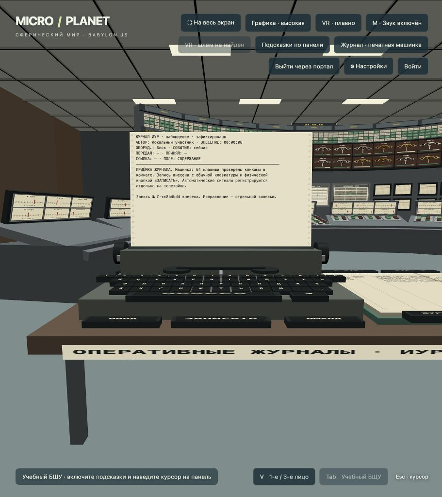

# Журнал и телетайп в комнате

Реализовано по исследовательскому `docs/JOURNAL.md`. Машинка вводит человеческие
записи в учебный бумажный журнал. Это выбранная для тренажёра адаптация, а не
доказанная реконструкция устройства или бланка конкретного блока.

Кнопка **«Журнал · печатная машинка»** переводит к столу за операторскими пультами.
В VR к столу подходят самостоятельно. Все 64 клавиши машинки и рабочего места
являются геометрией с обработкой луча, включая русские буквы, цифры, пробел,
забой и двоеточие. Окно журнала поверх сцены не открывается.

- **ВВОД** включает обычную клавиатуру; текст появляется на листе машинки.
  **Tab / ПОЛЕ** переключает содержание, оборудование, время события,
  передающего, принимающего и ссылку на запись. **Esc / ВЫХОД** завершает ввод.
- **ЖУРНАЛ** выбирает ИУР, НСБ или турбинную часть. **ВИД** выбирает наблюдение,
  доклад, распоряжение, результат, исправление, сдачу либо приём смены.
  **СТАТУС** меняет явно заявленный автором статус.
- **ЗАПИСАТЬ / Ctrl+Enter** добавляет неизменяемую запись с автором и временем
  внесения. Для поздней записи отдельно указывают время события `ММ:СС` или
  `ЧЧ:ММ:СС` по часам упражнения. Пустое поле означает текущее время.
  Дополнительно сохраняется календарная дата внесения UTC по часам браузера.
- **ФОРМУЛЯР** подставляет автора и ссылку на последнюю запись выбранного
  журнала; содержание остаётся за человеком. Номер другой записи можно ввести
  в поле ссылки самостоятельно.
- У распоряжения обязательны передающий и принимающий. Его первоначальный
  статус всегда «ожидается». Завершение фиксируется отдельным результатом со
  ссылкой; только явно подтверждённый результат закрывает открытый вопрос.
- Исправление не стирает прежний текст. Приём смены ссылается на запись о сдаче
  и требует другого участника. Книга показывает число открытых распоряжений;
  обе стороны описывают переданные вопросы в своих записях.
- Стрелки книги листают полные записи. **ВЫГРУЗИТЬ** сохраняет JSON с тремя
  отдельными потоками для разбора упражнения.

В общем режиме человеческие записи подтверждаются сервером и хранятся в
PostgreSQL вместе с состоянием упражнения; новый участник получает сохранённую
историю. До подтверждения запись остаётся черновиком. Архитектура, границы
серверного расчёта и миграция описаны в [RBMK_SERVER.md](RBMK_SERVER.md).
В локальном режиме без авторизации вкладка сохраняет только копию в
`sessionStorage`, которая может исчезнуть при закрытии вкладки. Нет
криптографических подписей и управления станционными должностями.

## Отдельные потоки

1. **Бумажная книга:** только явно внесённые человеком записи. Модель не
   дописывает туда причины отказа, скрытые параметры или содержание переговоров.
2. **Телетайп:** появление и исчезновение сигналов, а также измеряемые показания
   с отметкой источника и времени. Параметры печатаются раз в 60 секунд; этот
   интервал подписан как учебный и не выдаётся за исторический цикл СКАЛА.
   Стрелки ленты позволяют читать предыдущие сообщения.
3. **Протокол инструктора:** команды участников и их время. Хранится отдельно
   от оперативного журнала и попадает в выгрузку, а не на его страницы.

Кнопка **КАРТОГР.** переключает телетайп на расчётную сводку. Учебная сетка
8×8 выводится из текущей мощности и заданного пространственного профиля; она
явно подписана как расчётная, не является независимым измерением каналов и не
выдаётся за координатную карту реального реактора. Сводка и хронология различны.

Основания для разделения потоков: [INSAG-7, приложение I, с. 52–56, 76](https://www-pub.iaea.org/MTCD/publications/PDF/Pub913e_web.pdf)
и [Доллежаль, Емельянов, 1980, главы 6–7, рис. 6.8](https://elib.biblioatom.ru/text/dollezhal_kanalnyy-yadernyy-reaktor_1980/).
Подлинного рукописного разворота и универсального бланка РБМК в собранной
библиотеке нет. Современный пример ЛАЭС-2 относится к ВВЭР и не перенесён как
историческая форма.

## Проверка

`node --test services/soloapp_app/tests/*.test.mjs` проверяет неизменяемость,
раздельное время, распоряжения и результаты, исправления, две стороны передачи,
сигналы, измеряемые значения и импорт истории. Отдельный localhost-режим
`?reactor-test=1&reactor-journal-audit=1` только ставит камеру перед клавишей и
проверяет результат обычного клика по canvas. Он не вызывает команды напрямую.
Аппаратный WebXR-шлем в текущей среде отсутствует; работа контроллеров на
реальном устройстве ещё требует отдельного прогона.

Проход 01.11.2026: [64/64 клавиши](evidence/rbmk-journal-64.txt), 0 ошибок.
Дополнительно в обычном режиме запись напечатана с клавиатуры, внесена
физической кнопкой «ЗАПИСАТЬ» и открыта в книге.

